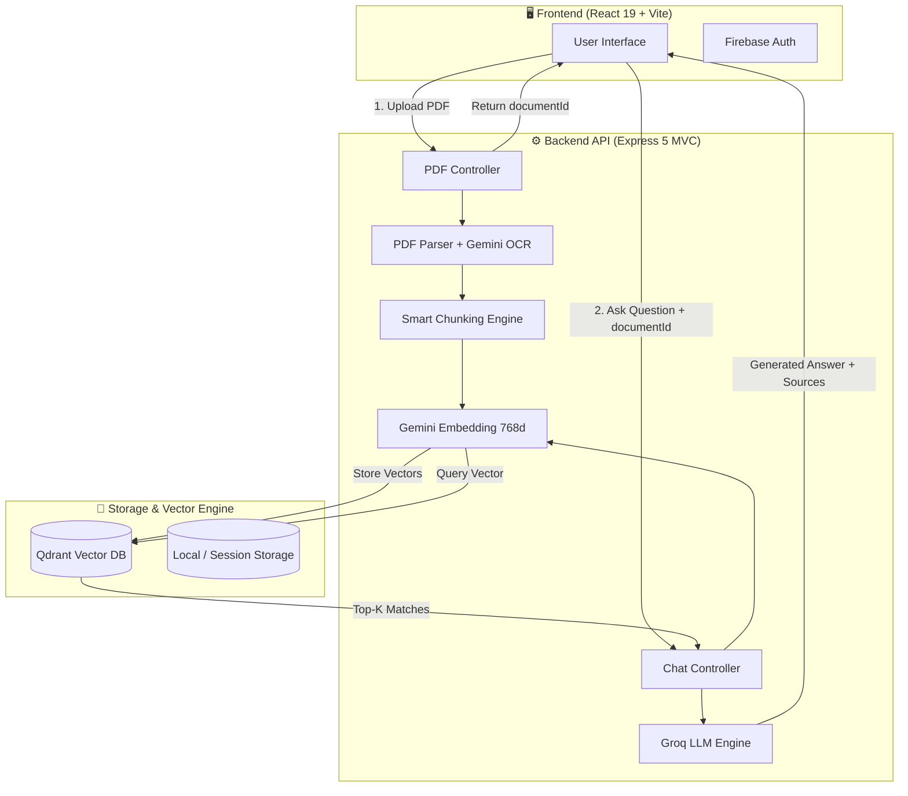

# ⚡ PDF Chat AI — Intelligent RAG Document Assistant

[](https://rag-beta-virid.vercel.app)
[](https://nodejs.org/)
[](https://react.dev/)
[](https://tailwindcss.com/)
[](https://qdrant.tech/)
[](https://groq.com/)
[](https://aistudio.google.com/)

An enterprise-grade, full-stack **Retrieval-Augmented Generation (RAG)** chatbot that lets you upload any PDF document and chat with it in real-time. Answers are generated **strictly from your document's context** and accompanied by **exact page citations and similarity confidence scores**.

---

## 🌟 Live Demo

- **Frontend App**: [https://rag-beta-virid.vercel.app](https://rag-beta-virid.vercel.app)
- **Backend API**: [https://rag-chat-pxsx.vercel.app](https://rag-chat-pxsx.vercel.app)

---

## 🚀 Key Features

- **🎯 Context-Strict Q&A**: Hallucination-resistant prompt engineering ensures the AI answers only using verified document context. If info isn't present, it transparently tells you.
- **📄 Page-Aware Citations**: Every answer provides clickable source citations with exact page numbers, similarity confidence scores, and preview snippets.
- **👁️ Dual-Engine Parsing (OCR Fallback)**:
  - Native selectable text extraction using fast stream parsing.
  - Automatic **Gemini 2.5 Flash Vision OCR** fallback when pages are scanned or image-based.
- **⚡ Ultra-Low Latency Inference**: Powered by **Groq** (`openai/gpt-oss-120b` with automatic fallback to `openai/gpt-oss-20b` and `gemini-2.5-flash`) with sub-second token generation.
- **🔍 Isolated Document Search**: Vector embeddings are indexed in **Qdrant** with strict `documentId` payload filtering — multiple PDFs and user sessions never cross-contaminate.
- **🔒 Firebase Authentication**: Google OAuth and Email/Password authentication with seamless local session persistence.
- **🎨 Modern Responsive UI**: Crafted with React 19, Tailwind CSS v4, dynamic dark theme accents, syntax-highlighted Markdown rendering, and quick query prompts.
- **☁️ Zero-Config Deployment**: 100% serverless-ready for **Vercel** with full CORS and canvas polyfills, plus **Render** (`render.yaml`) compatibility.

---

## 🏗️ Architecture & Workflow



---

## 🛠️ Tech Stack

| Domain | Technologies |
|---|---|
| **Frontend** | React 19, Vite, Tailwind CSS v4, Lucide React, React Markdown, Axios |
| **Backend** | Node.js (v20+), Express 5, Multer, MVC Architecture |
| **Vector Database** | Qdrant (Cosine similarity with payload keyword index) |
| **Embeddings** | Google Gemini `gemini-embedding-001` (768 dimensions) |
| **Vision / OCR** | Google Gemini `gemini-2.5-flash` |
| **LLM Inference** | Groq SDK (`openai/gpt-oss-120b`, `openai/gpt-oss-20b`) & Gemini fallback |
| **Authentication** | Firebase Authentication (Google Sign-In & Email/Password) |
| **Hosting** | Vercel (Frontend & Serverless Backend) / Render |

---

## 📁 Repository Structure

```text
Rag-Chat/
├── backend/
│   ├── api/
│   │   └── index.js             # Vercel Serverless Function entrypoint
│   ├── src/
│   │   ├── config/
│   │   │   └── env.js           # Centralized environment configuration
│   │   ├── controllers/
│   │   │   ├── chat.controller.js # RAG retrieval and response handler
│   │   │   └── pdf.controller.js  # PDF upload and indexing handler
│   │   ├── middleware/
│   │   │   ├── error.middleware.js  # Global error & CORS handler
│   │   │   └── upload.middleware.js # In-memory Multer file filter
│   │   ├── models/
│   │   │   └── vector.model.js  # Qdrant client, schema & search queries
│   │   ├── routes/
│   │   │   ├── chat.routes.js   # POST /api/chat
│   │   │   ├── history.routes.js# Chat session history endpoints
│   │   │   ├── pdf.routes.js    # POST /api/pdf/upload
│   │   │   └── index.js         # API route aggregation
│   │   ├── services/
│   │   │   ├── chunk.service.js # Overlapping text sliding-window chunker
│   │   │   ├── embedding.service.js # Gemini batch embedding service
│   │   │   ├── llm.service.js   # Groq LLM integration
│   │   │   └── pdf.service.js   # PDF text extraction with OCR fallback
│   │   ├── utils/
│   │   │   └── prompt.js        # RAG context builder
│   │   └── server.js            # Express application bootstrap & CORS
│   ├── .env.example
│   ├── package.json
│   ├── server.js                # Build proxy
│   └── vercel.json              # Vercel serverless deployment config
│
├── frontend/
│   ├── src/
│   │   ├── components/          # Modular UI components (Chat, Sidebar, Header, etc.)
│   │   ├── api.js               # Centralized Axios client & endpoints
│   │   ├── firebase.js          # Auth initialization & session history manager
│   │   ├── App.jsx              # Main chat application layout & state
│   │   └── index.css            # Tailwind CSS v4 styling
│   ├── .env.example
│   ├── package.json
│   ├── vercel.json              # SPA rewrite configuration
│   └── vite.config.js
│
├── render.yaml                  # Optional Render Blueprint deployment
└── README.md
```

---

## ⚙️ Configuration & Environment Variables

### Backend (`backend/.env`)

Copy `backend/.env.example` to `backend/.env`:

```env
# Server
PORT=5000
CORS_ORIGIN=https://rag-beta-virid.vercel.app,http://localhost:5173

# Qdrant Vector DB (Local Docker or Qdrant Cloud)
QDRANT_URL=http://localhost:6333
QDRANT_API_KEY=
QDRANT_COLLECTION=pdf_documents

# Groq LLM API (https://console.groq.com)
GROQ_API_KEY=your_groq_api_key_here
GROQ_MODEL=openai/gpt-oss-120b

# Google Gemini API (https://aistudio.google.com)
GEMINI_API_KEY=your_gemini_api_key_here
EMBEDDING_MODEL=gemini-embedding-001
EMBEDDING_DIMENSIONS=768
GEMINI_VISION_MODEL=gemini-2.5-flash
PDF_VISION_ENABLED=true

# Upload & Search Knobs
MAX_UPLOAD_MB=15
RAG_TOP_K=6
RAG_MIN_SCORE=0.25
```

### Frontend (`frontend/.env`)

Copy `frontend/.env.example` to `frontend/.env`:

```env
# Backend API Base URL
VITE_API_URL=https://rag-chat-pxsx.vercel.app/api

# Firebase Authentication (Firebase Console -> Project Settings)
VITE_FIREBASE_API_KEY=your_firebase_api_key
VITE_FIREBASE_AUTH_DOMAIN=your_project.firebaseapp.com
VITE_FIREBASE_PROJECT_ID=your_project_id
VITE_FIREBASE_STORAGE_BUCKET=your_project.firebasestorage.app
VITE_FIREBASE_MESSAGING_SENDER_ID=your_messaging_id
VITE_FIREBASE_APP_ID=your_app_id
```

---

## 🏃 Running Locally

### 1. Start Qdrant

Using Docker:
```bash
docker run -p 6333:6333 -p 6334:6334 qdrant/qdrant
```
*(Or create a free cluster on [cloud.qdrant.io](https://cloud.qdrant.io) and set `QDRANT_URL` and `QDRANT_API_KEY` in `.env`)*

### 2. Start Backend

```bash
cd backend
npm install
npm run dev
```
Backend runs at `http://localhost:5000`.

### 3. Start Frontend

```bash
cd frontend
npm install
npm run dev
```
Frontend runs at `http://localhost:5173`.

### 4. Running Tests

```bash
cd backend
npm test
```

---

## 📡 API Reference

### Health Check
- **`GET /health`** or **`GET /api/health`**
- **Response**: `{ "success": true, "status": "ok", "maxUploadMb": 15 }`

### Upload & Index PDF
- **`POST /api/pdf/upload`**
- **Content-Type**: `multipart/form-data`
- **Body**: Form field `pdf` (PDF file, max 15MB)
- **Response**:
```json
{
  "success": true,
  "message": "PDF processed and indexed successfully.",
  "documentId": "488fbdf4-d621-4d37-8854-4f25bfa17c66",
  "fileName": "MachineLearningHandbook.pdf",
  "totalPages": 18,
  "indexedPages": 18,
  "totalChunks": 42
}
```

### Chat with Document
- **`POST /api/chat`**
- **Content-Type**: `application/json`
- **Body**:
```json
{
  "question": "What is gradient descent and how does it converge?",
  "documentId": "488fbdf4-d621-4d37-8854-4f25bfa17c66"
}
```
- **Response**:
```json
{
  "success": true,
  "question": "What is gradient descent and how does it converge?",
  "answer": "Gradient descent is an optimization algorithm that iteratively updates model parameters in the opposite direction of the gradient...",
  "sources": [
    {
      "fileName": "MachineLearningHandbook.pdf",
      "pageNumber": 4,
      "chunkIndex": 8,
      "score": 0.882,
      "snippet": "Convergence occurs when step size approaches zero..."
    }
  ]
}
```

---

## 🚢 Deployment Guide

### Deploying Frontend (Vercel)
1. Import `mehul-vi/Rag-Chat` on [vercel.com/new](https://vercel.com/new).
2. Set **Root Directory** to `frontend`.
3. Framework Preset: **Vite**.
4. Add environment variables from `frontend/.env.example` (make sure `VITE_API_URL` points to your backend).
5. Click **Deploy**.

### Deploying Backend (Vercel Serverless)
1. Import `mehul-vi/Rag-Chat` on [vercel.com/new](https://vercel.com/new).
2. Set **Root Directory** to `backend`.
3. Add environment variables (`GROQ_API_KEY`, `GEMINI_API_KEY`, `QDRANT_URL`, `QDRANT_API_KEY`, etc.).
4. Click **Deploy**. Vercel will use `@vercel/node` and route all requests through `api/index.js`.

---

## 🛡️ License

This project is licensed under the [ISC License](LICENSE).

---

<p align="center">
  Built with ❤️ by <a href="https://github.com/mehul-vi">Mehul Kumar Sahu</a>
</p>
